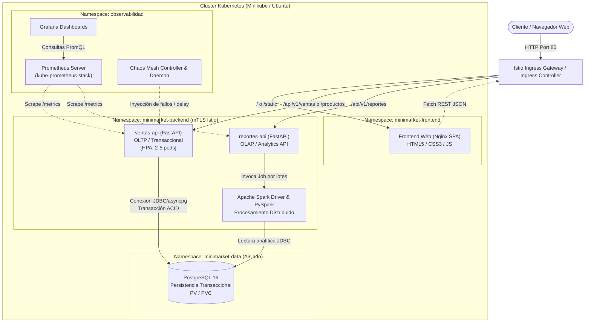

# Arquitectura de Software, Datos e Infraestructura — MiniMarket Cloud

Este documento describe la arquitectura global del sistema **MiniMarket Cloud**, concebido bajo estándares de ingeniería Cloud-native para satisfacer la totalidad de requerimientos técnicos de la rúbrica de Servicios Cloud (UTP).

---

## 1. Visión General de la Solución

MiniMarket Cloud es una arquitectura basada en microservicios desacoplados, contenerizados en Docker y orquestados en Kubernetes. Separa estrictamente las cargas de trabajo transaccionales OLTP (registro de ventas, control de catálogo y actualización de inventario) de las cargas analíticas OLAP (agregaciones históricas y rankings mediante procesamiento distribuido con Apache Spark).

---

## 2. Componentes del Sistema

### 2.1. Frontend Web (Capa de Presentación)
- **Tecnología:** HTML5 semántico, CSS3 modular (diseño responsivo tipo punto de venta) y Vanilla JavaScript asíncrono (`fetch` API).
- **Servidor Web:** Empaquetado en imagen `nginx:alpine` ligera (~25 MB).
- **Responsabilidad:**
  - Consulta y renderizado en vivo del catálogo con stock disponible.
  - Formulario de alta rápida de productos.
  - Carrito de compras multi-ítem con validación en cliente.
  - Panel de reportes con actualización asíncrona de totales del día y gráfica de productos más vendidos.

### 2.2. Microservicio `ventas-api` (Capa de Negocio Transaccional)
- **Tecnología:** Python 3.11+, FastAPI, SQLAlchemy 2.0 (asíncrono) / `asyncpg`, Pydantic v2.
- **Responsabilidad:**
  - `CRUD` básico de productos.
  - Registro de ventas multi-ítem garantizando consistencia ACID (`BEGIN TRANSACTION` -> comprobación de existencias -> descuento atómico de inventario -> registro de cabecera y detalle -> `COMMIT` o `ROLLBACK`).
  - Exposición de métricas de negocio y de sistema en el endpoint `/metrics` (`prometheus-fastapi-instrumentator`).
  - Readiness y Liveness probes para orquestación en Kubernetes.

### 2.3. Base de Datos Relacional (`PostgreSQL 16`)
- **Tecnología:** PostgreSQL 16 desplegado como `StatefulSet` en Kubernetes.
- **Persistencia:** `PersistentVolumeClaim` (PVC) de 5 GiB respaldado por el `standard` StorageClass de Minikube.
- **Responsabilidad:** Almacenamiento seguro, índices sobre fechas y llaves foráneas para integridad referencial.

### 2.4. Microservicio `reportes-api` & Motor Distribuido `Apache Spark`
- **Tecnología:** FastAPI + PySpark 3.5.x.
- **Mecanismo de Procesamiento:**
  - `reportes-api` recibe solicitudes para generar agregaciones complejas (ventas agrupadas por fecha, suma total, ticket promedio, top productos).
  - Ejecuta un script de PySpark que lee las tablas `ventas` y `detalle_ventas` vía conector JDBC de PostgreSQL, distribuye las particiones en memoria (Spark DataFrames) y calcula las métricas analíticas.
  - Almacena los resultados o los devuelve en tiempo real al solicitante, reduciendo la carga computacional sobre la base transaccional principal.

---

## 3. Infraestructura, Redes y Seguridad

### 3.1. Segmentación por Namespaces
Se configuran cuatro namespaces en Kubernetes para garantizar separación de responsabilidades y aislamiento:
- `minimarket-frontend`: Aloja los pods de Nginx.
- `minimarket-backend`: Aloja `ventas-api`, `reportes-api` y los ejecutores de Spark.
- `minimarket-data`: Aloja el pod de PostgreSQL.
- `observabilidad`: Aloja Prometheus, Grafana y Chaos Mesh.

### 3.2. Aislamiento con NetworkPolicies
Se implementan políticas de red L3/L4 estrictas:
1. **Regla Frontend:** Solo acepta tráfico entrante desde el Ingress Gateway / Service Mesh y no tiene salida a la base de datos directa.
2. **Regla Backend:** Solo acepta tráfico HTTP desde el Frontend / Ingress y tiene salida permitida únicamente al namespace `minimarket-data` (puerto 5432) y al DNS interno del cluster.
3. **Regla Data (PostgreSQL):** Deniega todo tráfico entrante por defecto (`DefaultDeny`) y solo autoriza conexiones en el puerto `5432/TCP` provenientes de pods con etiqueta `app: ventas-api` y `app: spark-job` del namespace `minimarket-backend`.

### 3.3. Service Mesh (Istio)
- **Istio Ingress Gateway:** Punto de entrada único al cluster para dirigir rutas `/` al frontend y `/api/*` a las APIs correspondientes.
- **mTLS Estricto:** Cifrado mutuo transparente entre pods del backend y datos mediante sidecars `Envoy`.
- **Enrutamiento Inteligente:** `VirtualService` y `DestinationRule` para control de timeouts, retries y balanceo de carga.

---

## 4. Resiliencia, Autoescalado y Observabilidad

### 4.1. Autoescalado Horizontal (HPA)
- Despliegue de **Metrics Server** en Minikube.
- Definición de recurso `HorizontalPodAutoscaler` para `ventas-api`:
  - Mínimo de pods: 2.
  - Máximo de pods: 5.
  - Target métrico: 60% de utilización de CPU o saturación de peticiones por segundo.
- Validación con herramienta generadora de carga concurrente `hey`.

### 4.2. Ingeniería del Caos (Chaos Mesh)
- Inyección de fallas controladas para demostrar resiliencia de la arquitectura:
  - **Pod Chaos (Pod Failure):** Eliminación aleatoria de un pod de `ventas-api` bajo carga de `hey` para evidenciar que Kubernetes regenera el pod y el servicio se mantiene disponible sin caídas.
  - **Network Chaos (Latency Injection):** Introducción de 200 ms de latencia artificial para verificar el comportamiento de los timeouts de Istio y la degradación elegante del sistema.

### 4.3. Pila de Monitoreo (kube-prometheus-stack + Grafana)
- **Prometheus:** Descubrimiento automático de pods vía `ServiceMonitor` para recolectar métricas HTTP (latencia P95/P99, tasa de errores 5xx, throughput de ventas).
- **Grafana:** Tableros preconfigurados que correlacionan el tráfico de la prueba de carga `hey`, el disparo del HPA y los eventos de inyección de Chaos Mesh.

---

## 5. Dimensionamiento Físico y TCO (Datacenter On-Premise)

Para sustentar la equivalencia física de la solución frente a un despliegue On-Premise tradicional, se incluye un script interactivo en Bash (`infra/tco/dimensionamiento_tco.sh`):
- **Cálculo de Carga Térmica (BTU/hr):** Conversión de watts consumidos por servidores y switches a requerimientos de aire acondicionado de precisión.
- **Power Usage Effectiveness (PUE):** Modelado de eficiencia energética (factor estándar 1.4 - 1.6).
- **Cálculo de TCO (Total Cost of Ownership):** Comparativa a 3 años entre infraestructura física propia (servidores rack, UPS, energía eléctrica, mantenimiento de datacenter) vs. hosting gestionado en la nube.
