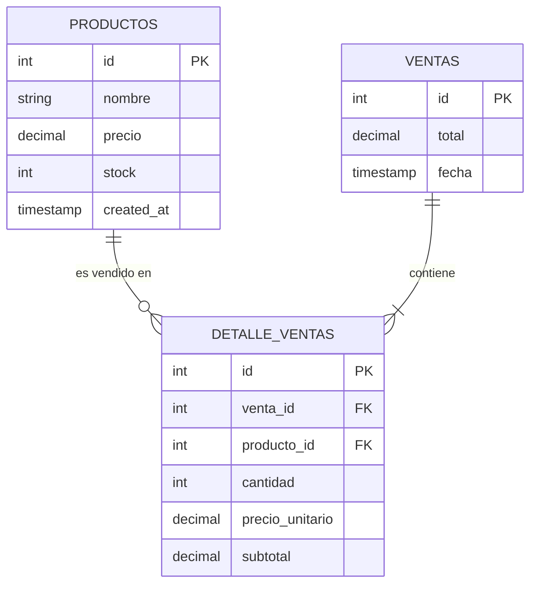

# Contratos de API y Especificación de Datos — MiniMarket Cloud

Este documento define de manera estricta los esquemas de datos, endpoints REST, códigos de estado HTTP y contratos JSON utilizados para la comunicación entre el **Frontend**, el microservicio **`ventas-api`** y el microservicio **`reportes-api`**.

---

## 1. Modelo de Datos Relacional (PostgreSQL)



---

## 2. Microservicio `ventas-api` (Puerto 8000)

Prefijo base: `/api/v1`

### 2.1. Endpoints de Salud y Métricas

- **`GET /health`**
  - **Propósito:** Liveness y readiness probes de Kubernetes.
  - **Respuesta:** `200 OK`
    ```json
    {
      "status": "ok",
      "service": "ventas-api",
      "database": "connected"
    }
    ```
- **`GET /metrics`**
  - **Propósito:** Scrapeo para Prometheus (`prometheus-fastapi-instrumentator`).
  - **Formato:** Texto plano con métricas estándar de Prometheus.

---

### 2.2. Endpoints de Catálogo de Productos

#### `GET /api/v1/productos`
- **Descripción:** Retorna el catálogo completo de productos con su stock actual.
- **Respuesta Exitosa (`200 OK`):**
```json
[
  {
    "id": 1,
    "nombre": "Arroz Costeño 1kg",
    "precio": 4.50,
    "stock": 50,
    "created_at": "2026-11-10T08:30:00Z"
  },
  {
    "id": 2,
    "nombre": "Aceite Primor 1L",
    "precio": 9.20,
    "stock": 30,
    "created_at": "2026-11-10T08:30:00Z"
  }
]
```

#### `POST /api/v1/productos`
- **Descripción:** Crea un nuevo producto en el catálogo.
- **Payload (`application/json`):**
```json
{
  "nombre": "Leche Gloria Azul 400g",
  "precio": 4.20,
  "stock": 100
}
```
- **Respuesta Exitosa (`201 Created`):**
```json
{
  "id": 3,
  "nombre": "Leche Gloria Azul 400g",
  "precio": 4.20,
  "stock": 100,
  "created_at": "2026-11-10T09:00:00Z"
}
```
- **Respuesta de Error de Validación (`422 Unprocessable Entity`):**
```json
{
  "detail": "El precio y el stock deben ser valores positivos mayores a cero."
}
```

---

### 2.3. Endpoints de Registro Transaccional de Ventas

#### `POST /api/v1/ventas`
- **Descripción:** Registra una venta con múltiples productos. Ejecuta una transacción atómica: valida existencia, verifica que haya stock suficiente para cada ítem, descuenta el stock inmediatamente y registra la cabecera y el detalle. Si cualquier ítem no tiene stock suficiente, la transacción se revierte (`ROLLBACK`).
- **Payload (`application/json`):**
```json
{
  "items": [
    {
      "producto_id": 1,
      "cantidad": 2
    },
    {
      "producto_id": 2,
      "cantidad": 1
    }
  ]
}
```
- **Respuesta Exitosa (`201 Created`):**
```json
{
  "id": 101,
  "total": 18.20,
  "fecha": "2026-11-10T10:15:30Z",
  "items": [
    {
      "producto_id": 1,
      "nombre": "Arroz Costeño 1kg",
      "cantidad": 2,
      "precio_unitario": 4.50,
      "subtotal": 9.00
    },
    {
      "producto_id": 2,
      "nombre": "Aceite Primor 1L",
      "cantidad": 1,
      "precio_unitario": 9.20,
      "subtotal": 9.20
    }
  ]
}
```
- **Respuesta de Error por Stock Insuficiente (`400 Bad Request`):**
```json
{
  "error": "STOCK_INSUFICIENTE",
  "mensaje": "Stock insuficiente para el producto 'Aceite Primor 1L'. Stock actual: 2, solicitado: 5."
}
```
- **Respuesta de Error por Producto Inexistente (`404 Not Found`):**
```json
{
  "error": "PRODUCTO_NO_ENCONTRADO",
  "mensaje": "El producto con ID 99 no existe en el catálogo."
}
```

#### `GET /api/v1/ventas`
- **Descripción:** Lista el historial reciente de ventas registradas.
- **Respuesta Exitosa (`200 OK`):**
```json
[
  {
    "id": 101,
    "total": 18.20,
    "fecha": "2026-11-10T10:15:30Z",
    "total_items": 2
  }
]
```

---

## 3. Microservicio `reportes-api` (Puerto 8001)

Prefijo base: `/api/v1/reportes`

### 3.1. Endpoints de Salud
- **`GET /health`**
  - **Respuesta:** `200 OK`
    ```json
    {
      "status": "ok",
      "service": "reportes-api",
      "spark_engine": "ready"
    }
    ```

---

### 3.2. Endpoints Analíticos (Procesamiento Spark)

#### `GET /api/v1/reportes/ventas-diarias`
- **Parámetros Query:**
  - `fecha` (opcional, formato `YYYY-MM-DD`, por defecto fecha actual).
- **Descripción:** Ejecuta la agregación de ventas diarias vía PySpark sobre la tabla de ventas, consolidando transacciones.
- **Respuesta Exitosa (`200 OK`):**
```json
{
  "fecha": "2026-11-10",
  "total_ingresos": 1420.50,
  "total_transacciones": 48,
  "ticket_promedio": 29.59,
  "motor_procesamiento": "Apache Spark 3.5.x"
}
```

#### `GET /api/v1/reportes/productos-top`
- **Parámetros Query:**
  - `limite` (opcional, entero, por defecto `5`).
- **Descripción:** Ejecuta el job distribuido de PySpark que une `detalle_ventas` y `productos`, calculando los artículos de mayor rotación y recaudación.
- **Respuesta Exitosa (`200 OK`):**
```json
{
  "criterio": "volumen_unidades",
  "generado_en": "2026-11-10T11:00:00Z",
  "ranking": [
    {
      "ranking": 1,
      "producto_id": 1,
      "nombre": "Arroz Costeño 1kg",
      "unidades_vendidas": 150,
      "total_recaudado": 675.00
    },
    {
      "ranking": 2,
      "producto_id": 3,
      "nombre": "Leche Gloria Azul 400g",
      "unidades_vendidas": 120,
      "total_recaudado": 504.00
    },
    {
      "ranking": 3,
      "producto_id": 2,
      "nombre": "Aceite Primor 1L",
      "unidades_vendidas": 65,
      "total_recaudado": 598.00
    }
  ]
}
```

#### `POST /api/v1/reportes/trigger-batch`
- **Descripción:** Dispara manualmente el procesamiento batch en Spark para actualizar tablas analíticas pre-agregadas.
- **Respuesta Exitosa (`202 Accepted`):**
```json
{
  "job_id": "spark-job-batch-20261110-01",
  "status": "RUNNING",
  "mensaje": "Job de PySpark despachado satisfactoriamente."
}
```
