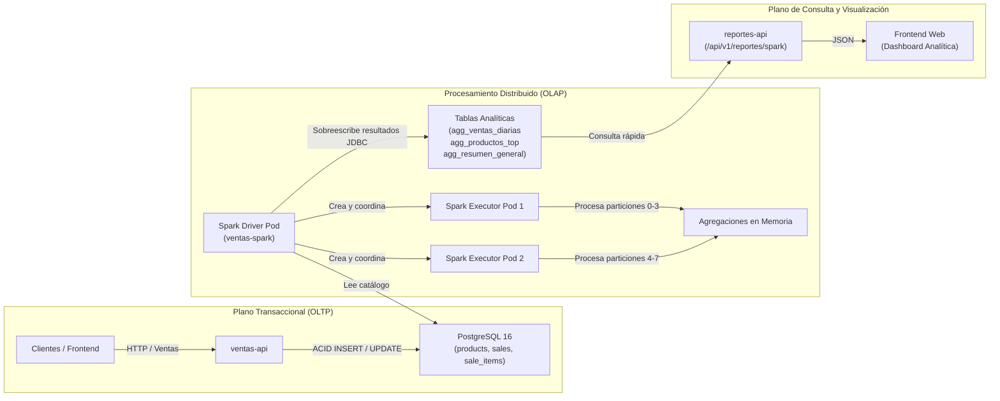

# Arquitectura de Datos y Procesamiento Distribuido

## 1. Visión General del Flujo de Datos

MiniMarket Cloud separa estrictamente el plano transaccional OLTP del plano analítico OLAP por lotes:

---

## 2. Esquema Relacional Analítico (Tablas `agg_*`)

Generadas y mantenidas por la migración Alembic [`002_agregados_spark`](file:///Users/cristopher/Minimarket/src/ventas-api/alembic/versions/002_agregados_spark.py):

### Tabla: `agg_ventas_diarias`
Almacena la métrica de ventas e ingresos agrupados por fecha:
- `fecha DATE PRIMARY KEY`: Día calendárico analizado.
- `numero_ventas BIGINT NOT NULL`: Total de transacciones completadas en la fecha.
- `total_ingresos NUMERIC(16, 2) NOT NULL`: Facturación acumulada en moneda local.
- `procesado_en TIMESTAMP WITH TIME ZONE NOT NULL DEFAULT now()`: Marca de tiempo de ejecución del job.

### Tabla: `agg_productos_top`
Almacena el ranking de desempeño de productos por volumen y facturación:
- `ranking INTEGER PRIMARY KEY`: Posición ordinal (1 = más vendido).
- `product_id INTEGER NOT NULL`: Identificador del producto del catálogo base.
- `product_name VARCHAR(150) NOT NULL`: Nombre legible del producto.
- `unidades_vendidas BIGINT NOT NULL`: Cantidad total de unidades despachadas.
- `total_recaudado NUMERIC(16, 2) NOT NULL`: Ingreso total generado por este producto.
- `procesado_en TIMESTAMP WITH TIME ZONE NOT NULL DEFAULT now()`

### Tabla: `agg_resumen_general`
Fila única con estadísticas agregadas del negocio (controlada por `CHECK (id = 1)`):
- `id SMALLINT PRIMARY KEY CHECK (id = 1)`
- `total_ventas BIGINT NOT NULL`: Sumatoria global de ventas procesadas.
- `ingresos_totales NUMERIC(16, 2) NOT NULL`: Recaudación global.
- `total_productos INTEGER NOT NULL`: Total de referencias analizadas.
- `procesado_en TIMESTAMP WITH TIME ZONE NOT NULL DEFAULT now()`

---

## 3. Integración JDBC Segura con PostgreSQL 16

1. **Driver**: PostgreSQL JDBC `postgresql-42.7.3.jar` instalado en `/opt/spark/jars/`.
2. **Propiedades de conexión**:
   - `driver`: `org.postgresql.Driver`
   - `truncate`: `"true"` (limpia los registros existentes antes de insertar los nuevos sin destruir los índices de la tabla).
   - `mode`: `"overwrite"`
3. **Resolución de credenciales**:
   - [`ventas_spark.py`](file:///Users/cristopher/Minimarket/src/spark/jobs/ventas_spark.py) utiliza la función [`obtener_credenciales_bd()`](file:///Users/cristopher/Minimarket/src/spark/jobs/ventas_spark.py#L129), admitiendo de forma nativa la variable `DATABASE_URL` inyectada desde el Secret preexistente `backend-db-secret` del namespace `minimarket-backend`.
   - Ninguna contraseña se imprime en los logs de Spark.

---

## 4. Políticas de Red Calico (NetworkPolicies)

- **Namespace de ejecución**: `minimarket-backend`.
- **Acceso a PostgreSQL en `minimarket-data`**:
  La NetworkPolicy [`01-allow-postgres-from-backend.yaml`](file:///Users/cristopher/Minimarket/infra/k8s/network-policies/01-allow-postgres-from-backend.yaml) autoriza explícitamente pods con la etiqueta `app: spark-job` hacia el puerto 5432 de PostgreSQL.
- **Comunicación Driver ↔ Ejecutores**:
  Ocurre dentro de `minimarket-backend` a través del puerto del driver (`7078`) y blockManager (`7079`).
