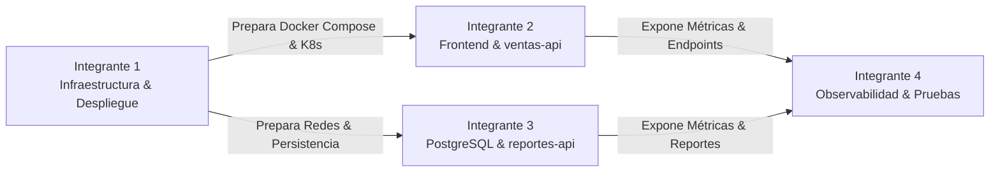

# Plan de Trabajo y Distribución por Integrantes — MiniMarket Cloud

Este documento establece la distribución equitativa de responsabilidades técnicas, propiedad de archivos y orden de integración para los cuatro integrantes del equipo en cumplimiento del proyecto de Servicios Cloud (UTP).

---

## 👥 Resumen de Asignación por Integrante



---

## 🛠️ Detalle de Roles y Responsabilidades (Etapa 1 y Siguientes)

### Integrante 1: Especialista en Infraestructura, Virtualización y Despliegue
- **Rol:** Diseñar la plataforma base, orquestación local con Docker Compose, empaquetado de contenedores y posterior despliegue en Kubernetes.
- **Ruta de Archivos Asignados:**
  - `docker-compose.yml` (Entorno de desarrollo local unificado: frontend, ventas-api, reportes-api, postgres).
  - `.env.example` y variables de entorno estándar.
  - `infra/multipass/cloud-init.yaml` (Aprovisionamiento automatizado de VM Ubuntu con cloud-init).
  - `infra/minikube/setup-minikube.sh` (Scripts de inicialización del cluster K8s).
  - `infra/k8s/namespaces/` y `infra/k8s/network-policies/` (Segmentación L3/L4).
  - `infra/helm/minimarket/` (Chart maestro para empaquetado en Kubernetes).
- **Entregables de la Etapa 1:**
  1. `docker-compose.yml` con aislamiento de redes y volumen persistente para PostgreSQL.
  2. Puertos de desarrollo mapeados sin colisionar con servicios preexistentes del host.
  3. Archivos `.env.example` estructurados sin secretos sensibles.

---

### Integrante 2: Desarrollador Fullstack, Lógica de Negocio e Instrumentación
- **Rol:** Construir la interfaz de usuario en Vanilla JS, la API transaccional de ventas con control estricto de concurrencia e instrumentación de métricas.
- **Ruta de Archivos Asignados:**
  - `src/frontend/index.html` (SPA: Inicio, Productos, Nueva Venta, Inventario, Reportes).
  - `src/frontend/css/style.css` (Diseño limpio, sobrio, moderno tipo POS, fondo claro y verde de éxito).
  - `src/frontend/js/app.js` (Lógica cliente, validaciones, Fetch API, estado de carga y modales).
  - `src/frontend/Dockerfile` y `src/frontend/nginx.conf`.
  - `src/ventas-api/app/main.py` (FastAPI app con endpoints `/api/v1/productos`, `/api/v1/ventas`, `/api/v1/inventario`).
  - `src/ventas-api/app/models.py` (Modelos SQLAlchemy: `Product`, `Sale`, `SaleItem`).
  - `src/ventas-api/app/schemas.py` (Esquemas Pydantic para validación y serialización).
  - `src/ventas-api/app/database.py` (Motor SQLAlchemy, sesiones y lógica transaccional).
  - `src/ventas-api/Dockerfile` y `src/ventas-api/requirements.txt`.
  - `infra/k8s/hpa/ventas-api-hpa.yaml` (Manifiesto de autoescalado HPA).
- **Entregables de la Etapa 1:**
  1. CRUD de productos con validaciones (precio > 0, stock >= 0, nombre obligatorio).
  2. Registro de venta atómico en PostgreSQL con bloqueo de fila (`with_for_update()`) para evitar sobreventa concurrente.
  3. Rollback inmediato si algún ítem no dispone de stock suficiente (conservando inventario intacto).
  4. Endpoints `/health`, `/ready` y `/metrics`.
  5. SPA completa con 5 vistas funcionales y manejo de errores.

---

### Integrante 3: Ingeniero de Datos, Persistencia y Analítica
- **Rol:** Modelar y versionar el almacenamiento relacional, inicializar datos semilla de bodega y construir la API de reportes analíticos.
- **Ruta de Archivos Asignados:**
  - `src/ventas-api/alembic/` (Migraciones versionadas con Alembic para PostgreSQL).
  - `src/ventas-api/app/seed.py` (Carga idempotente de productos peruanos: arroz, azúcar, leche Gloria, Inka Kola, galletas, etc.).
  - `src/reportes-api/app/main.py` (FastAPI app para reportes: ventas hoy, top productos, ventas por día).
  - `src/reportes-api/app/database.py` y `src/reportes-api/app/schemas.py`.
  - `src/reportes-api/Dockerfile` y `src/reportes-api/requirements.txt`.
  - `src/spark/jobs/` (Jobs analíticos PySpark para etapas posteriores).
- **Entregables de la Etapa 1:**
  1. Migraciones Alembic aplicadas generando las tablas `products`, `sales`, `sale_items`.
  2. Script de seed idempotente con productos de prueba de bodega peruana.
  3. `reportes-api` independiente respondiendo a los contratos de reporte con consultas SQL optimizadas.
  4. Endpoints `/health`, `/ready` y `/metrics` en `reportes-api`.

---

### Integrante 4: Ingeniero de Observabilidad, Calidad y Sustentación
- **Rol:** Garantizar la calidad de software mediante pruebas automatizadas (pytest), configurar la telemetría y preparar la sustentación técnica.
- **Ruta de Archivos Asignados:**
  - `tests/test_products.py` (Pruebas unitarias y de integración de productos y validaciones).
  - `tests/test_sales.py` (Pruebas de atomicidad, rollback, stock insuficiente y concurrencia).
  - `tests/test_reports.py` (Pruebas de endpoints analíticos y resúmenes).
  - `tests/test_health_metrics.py` (Pruebas de `/health`, `/ready` y `/metrics`).
  - `observability/istio/` y `observability/chaos-mesh/` (Para etapas posteriores).
  - `infra/tco/dimensionamiento_tco.sh` (Script de cálculo térmico, potencia y TCO).
- **Entregables de la Etapa 1:**
  1. Suite completa de 10 pruebas automatizadas en `pytest` pasando satisfactoriamente.
  2. Cobertura de casos límite: sobreventa, precio cero/negativo, transacción fallida y rollback.
  3. Verificación de exposición de métricas Prometheus en formato OpenMetrics.

---

## 🔄 Matriz de Dependencias y Orden de Ejecución

```text
Paso 1 (Integrante 1 & 3):
  └── Configuración de Base de Datos PostgreSQL, variables de entorno y migraciones Alembic.
  └── Ejecución del seed de datos de demostración de bodega.

Paso 2 (Integrante 2):
  └── Implementación de ventas-api (modelos, esquemas, transacciones ACID con SELECT FOR UPDATE).
  └── Desarrollo del Frontend SPA (5 vistas, interfaz POS, Fetch API).

Paso 3 (Integrante 3):
  └── Implementación de reportes-api (consultas SQL de agregación y endpoints REST).

Paso 4 (Integrante 4):
  └── Ejecución de la suite completa de pruebas pytest (10 escenarios obligatorios).
  └── Verificación de métricas Prometheus y salud de los servicios.

Paso 5 (Integrante 1 & Equipo):
  └── Verificación del entorno unificado con Docker Compose.
```
