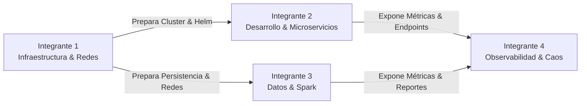

# Plan de Trabajo y Distribución por Integrantes — MiniMarket Cloud

Este documento establece la distribución equitativa de responsabilidades técnicas, propiedad de archivos y orden de integración para los cuatro integrantes del equipo en cumplimiento del proyecto de Servicios Cloud.

---

## 👥 Resumen de Asignación por Integrante



---

## 🛠️ Detalle de Roles y Responsabilidades

### Integrante 1: Especialista en Infraestructura, Virtualización y Despliegue
- **Rol:** Diseñar la plataforma base, automatizar el aprovisionamiento de nodos, definir el empaquetado del cluster y blindar la seguridad de red.
- **Ruta de Archivos Asignados:**
  - `infra/multipass/cloud-init.yaml` (Aprovisionamiento automatizado de VM Ubuntu con cloud-init).
  - `infra/multipass/setup-vm.sh` (Script de automatización de creación de VM).
  - `infra/minikube/setup-minikube.sh` (Script de arranque reproducible de Minikube).
  - `infra/k8s/namespaces/` (Definición de namespaces aislados).
  - `infra/k8s/network-policies/` (Políticas de aislamiento L3/L4 entre frontend, backend y base de datos).
  - `infra/helm/minimarket/` (Chart maestro: `Chart.yaml`, `values.yaml`, templates de Deployments, Services, ConfigMaps, Secrets y PVCs).
- **Hitos de Entrega:**
  1. VM Ubuntu aprovisionada con Cloud-init y Minikube operativo.
  2. Chart de Helm modular verificado con `helm lint` y desplegable con un solo comando.
  3. Políticas de red validadas mediante pruebas de conectividad denegada y permitida.

---

### Integrante 2: Desarrollador Fullstack, Lógica de Negocio y Resiliencia
- **Rol:** Construir la interfaz de usuario, desarrollar la API transaccional de ventas con control estricto de concurrencia e instrumentar la aplicación para escalamiento.
- **Ruta de Archivos Asignados:**
  - `src/frontend/index.html` (Estructura de la SPA: catálogo, carrito y panel de reportes).
  - `src/frontend/css/style.css` (Diseño limpio, responsivo y moderno tipo POS).
  - `src/frontend/js/app.js` (Lógica cliente, peticiones asíncronas REST, manejo de estados).
  - `src/frontend/Dockerfile` y `src/frontend/nginx.conf`.
  - `src/ventas-api/app/main.py` (FastAPI app con endpoints de productos y ventas).
  - `src/ventas-api/app/models.py` (Esquemas Pydantic para requests y responses).
  - `src/ventas-api/app/database.py` (Lógica transaccional ACID y descuento atómico de stock).
  - `src/ventas-api/Dockerfile` y `src/ventas-api/requirements.txt`.
  - `infra/k8s/hpa/ventas-api-hpa.yaml` (Definición del recurso Horizontal Pod Autoscaler).
- **Hitos de Entrega:**
  1. Microservicio `ventas-api` funcional con prueba de descuento atómico y rollback por falta de stock.
  2. Frontend SPA integrado consumiendo el catálogo en tiempo real y enviando pedidos multi-ítem.
  3. Endpoint `/metrics` instrumentado y HPA probado con escalamiento automático.

---

### Integrante 3: Ingeniero de Datos, Persistencia y Computación Distribuida
- **Rol:** Gestionar el almacenamiento relacional transaccional, modelar los datos y construir los flujos de analítica distribuida con Apache Spark.
- **Ruta de Archivos Asignados:**
  - `src/ventas-api/app/db_schema.sql` (DDL de tablas: `productos`, `ventas`, `detalle_ventas` e índices).
  - `infra/k8s/postgres/` o plantillas Helm correspondientes al `StatefulSet` y `PVC` de PostgreSQL.
  - `src/spark/jobs/reporte_diario.py` (Job PySpark de consolidación de ventas diarias e ingresos).
  - `src/spark/jobs/productos_top.py` (Job PySpark para ranking de productos con mayor volumen).
  - `src/reportes-api/app/main.py` (FastAPI app que expone los endpoints de reportes analíticos).
  - `src/reportes-api/app/spark_jobs.py` (Ejecutor / despachador de jobs Spark).
  - `src/reportes-api/Dockerfile` y `src/reportes-api/requirements.txt`.
- **Hitos de Entrega:**
  1. Base de datos PostgreSQL inicializada con datos semilla de productos y volumen persistente.
  2. Scripts de PySpark ejecutando agregaciones analíticas mediante lectura JDBC.
  3. API de reportes (`reportes-api`) sirviendo las consultas procesadas por Spark.

---

### Integrante 4: Ingeniero de Observabilidad, Service Mesh y Sustentación Técnica
- **Rol:** Implementar el control de tráfico inteligente con Istio, las pruebas de inyección de fallos con Chaos Mesh, el monitoreo con Grafana y el modelo de dimensionamiento TCO.
- **Ruta de Archivos Asignados:**
  - `observability/istio/gateway.yaml` (Istio Ingress Gateway para enrutamiento único).
  - `observability/istio/virtual-service.yaml` (Reglas de ruteo L7 y mTLS).
  - `observability/prometheus-grafana/servicemonitors.yaml` (Reglas de scrapeo de métricas).
  - `observability/prometheus-grafana/dashboard-minimarket.json` (Tablero preconfigurado de Grafana).
  - `observability/chaos-mesh/pod-failure.yaml` y `latency-injection.yaml` (Experimentos de caos).
  - `tests/load/hey-test.sh` (Script automatizado de pruebas de carga con la herramienta `hey`).
  - `infra/tco/dimensionamiento_tco.sh` (Script interactivo en Bash de cálculo térmico, BTU y TCO a 3 años).
- **Hitos de Entrega:**
  1. Istio Service Mesh operativo con mTLS y enrutamiento verificado.
  2. Dashboard de Grafana reflejando métricas HTTP en vivo y salud de los pods.
  3. Escenario de resiliencia demostrado: inyección de fallos con Chaos Mesh bajo estrés de `hey` con HPA activo.
  4. Script de TCO ejecutado en vivo durante la defensa del proyecto.

---

## 🔄 Matriz de Dependencias y Orden de Integración

```text
Fase 1: Preparación del Entorno
├── Integrante 1: Valida Minikube y define los namespaces y políticas de red iniciales.
└── Integrante 3: Configura el schema DDL y el contenedor de PostgreSQL con persistencia.

Fase 2: Core Transaccional
├── Integrante 2: Desarrolla ventas-api y prueba localmente contra PostgreSQL.
└── Integrante 2: Construye la SPA frontend básica con formulario de venta y visualización de stock.

Fase 3: Computación Distribuida
└── Integrante 3: Desarrolla y ejecuta los jobs de PySpark leyendo ventas de prueba desde PostgreSQL.
└── Integrante 3: Implementa reportes-api y la conecta con la SPA del Integrante 2.

Fase 4: Empaquetado y Orquestación K8s
└── Integrante 1: Integra todos los Dockerfiles y construye el Chart de Helm unificado.
└── Integrante 1: Realiza el despliegue general en Minikube bajo las NetworkPolicies.

Fase 5: Malla, Observabilidad y Resiliencia
├── Integrante 4: Inyecta el sidecar de Istio en los pods y valida el Gateway.
├── Integrante 4: Despliega kube-prometheus-stack y conecta el dashboard de Grafana.
├── Integrante 2 & 4: Configuran y calibran el HPA con Metrics Server.
└── Integrante 4: Ejecuta pruebas de estrés con hey e inyecta caos con Chaos Mesh.

Fase 6: Sustentación y Validación Final
└── Todos los integrantes: Ensayo conjunto de defensa con el script de TCO y checklist de rúbrica.
```
